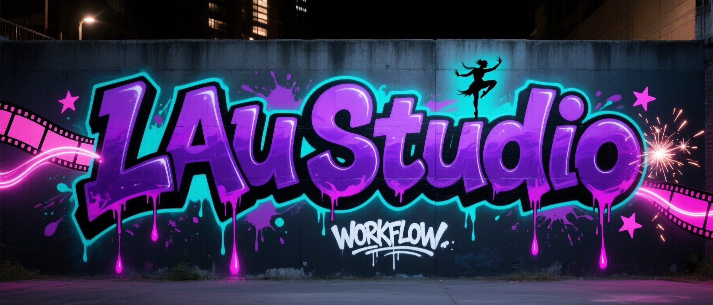
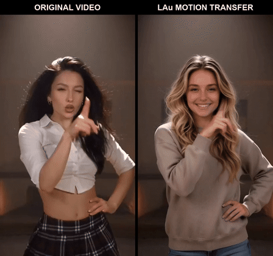
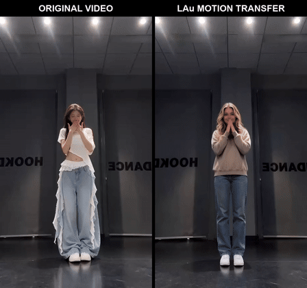
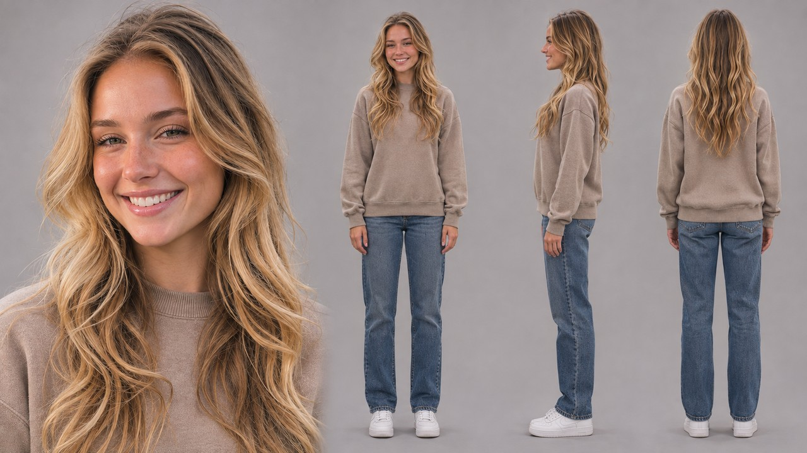

<p align="center">
  
</p>

<h1 align="center">LAu Motion Transfer · ComfyUI</h1>

<p align="center">
  <b>Swap the person in any dance or motion clip with your own character.</b><br>
  The moves, the camera, the background and the original sound stay the same.
</p>

<p align="center">
  
  
  
  
</p>

<p align="center"><sub>A <b>LAu Studios</b> project</sub></p>

<p align="center"><b><a href="#english">English</a> · <a href="#português">Português</a></b></p>

---

## Examples · Exemplos

Both examples use the same two reference pictures and the default settings (face refine **Adaptive**, no realism LoRAs, 5 seconds). Click a GIF to open the full video with sound.

<table>
  <tr>
    <th>Example 1 · Exemplo 1</th>
    <th>Example 2 · Exemplo 2</th>
  </tr>
  <tr>
    <td align="center"><a href="docs/videos/comparison_01.mp4"></a></td>
    <td align="center"><a href="docs/videos/comparison_02.mp4"></a></td>
  </tr>
  <tr>
    <td align="center">
      Reference video: <a href="docs/videos/reference_video_01.mp4">reference_video_01.mp4</a> (part from 9.83 s to 15 s)<br>
      Result: <a href="docs/videos/result_01.mp4">result_01.mp4</a> (1152 × 2064, original audio)
    </td>
    <td align="center">
      Reference video: <a href="docs/videos/reference_video_02.mp4">reference_video_02.mp4</a> (first 5 s)<br>
      Result: <a href="docs/videos/result_02.mp4">result_02.mp4</a> (1152 × 2064, original audio)
    </td>
  </tr>
</table>

**Reference pictures · Imagens de referência**

<table>
  <tr>
    <th>Picture 1 · face (rosto)</th>
    <th>Picture 2 · character sheet / outfit (folha do personagem / roupa)</th>
  </tr>
  <tr>
    <td align="center"></td>
    <td align="center"></td>
  </tr>
</table>

---

## English

**LAu Motion Transfer** replaces the person in a dance or motion clip with your own character. It runs on **MiniMax H3** (Ref2VA + the Pika Flex adapter) and was tested on a 16 GB card (RTX 5070 Ti, 128 GB RAM).

This repository contains:

- **`example_workflows/LAu_Motion_Transfer.json`**: the workflow. After installing, it shows up in ComfyUI under *Templates → Custom nodes → LAu Motion Transfer*.
- **10 helper nodes** (category *LAu Motion Transfer*) that the workflow uses, plus the **LAu Studio** banner.

### Quick start

1. Install the packs and models listed below, then restart ComfyUI.
2. Open the template **LAu Motion Transfer**.
3. In **3 · Your input**: load your video, **Picture 1** (a clear front photo of the face) and, optionally, **Picture 2** (full body or outfit sheet).
4. In the purple **Clip range** node, choose where the part to copy starts and how many seconds it lasts.
5. Select **▶ REFRESH THE FRAME** and press **Run selected**. The Points Editor now shows the first frame of that part.
6. Mark the person to replace with 3 to 5 green points on the body (see the guide next to the editor), then press **Run**.
7. The result is saved in `output/LAu_Motion_Transfer/`, with the original audio.

### What the workflow does

1. Segments the person in the source video (SeC) and builds a depth guide (Video Depth Anything).
2. Generates the clip with your character using H3 Ref2VA + Pika Flex + the **Character swap LoRA v1.5** (akatz-ai, switch on by default). *Picture 1* is the face; *Picture 2* is an optional full-body or outfit sheet.
3. Optional face refine: **Adaptive** (H3-FaceRefine, recommended) or **T8**. With the **Precise face mask** switch (on by default), **SAM3** finds the face in every crop and only that area is re-rendered and pasted back. The **Face Size Fade** node (PixelAI Labs) applies the refine fully on small, distant faces and leaves close-ups as H3 made them.
4. Saves the final video with the original audio and, optionally, a side-by-side comparison (original video | result) and debug files.

All choices are on the switch cards in **1 · Settings** (Mode, Face refine, Extras). Purple nodes are the ones you change on each run.

**Mode** card:

| Mode | What changes | What stays from the original video |
|---|---|---|
| **Role Swap** | the whole person: face, hair, body and clothes | motion, camera, scene, sound |
| **Fashion** | optional fashion clip from Picture 1 / Picture 2 | — |
| **Face only** | only the face, redrawn from Picture 1 | hair, body, clothes, motion, camera, scene, sound |

In **Face only** the H3 generation and the SeC segmentation do not run: the Adaptive face refine works straight on the original video (follows the face of the video, refines every frame, denoise 0.8 set on the *SWAP AREA* node). No points are needed.

### Nodes

| Node | What it does |
|---|---|
| LAu Motion Transfer · Modes & Outputs | Central control. The switch cards write it, and its outputs turn each branch on or off |
| LAu Motion Transfer · Duration (H3 frame grid) | Picks the part of the source clip to copy (start + seconds) and rounds the length up to a frame count H3 accepts (17n + 5 at 24 fps) |
| LAu Motion Transfer · Optional LoRA | Applies a LoRA only when enabled. When disabled, the file is not needed |
| LAu Motion Transfer · Save Video (if enabled) | Saves an MP4. When disabled, that branch is not even computed |
| LAu Motion Transfer · Optional Sparse Attention | Optional Sol-Attn speed patch (off = dense) |
| LAu Motion Transfer · T8 Face Stitch | Runs the T8 face stitch only when T8 is the selected face refine |
| LAu Motion Transfer · Trim Video + Audio | Cuts the result to the exact frames loaded from the source and the audio to the same length |
| LAu Motion Transfer · Labeled Comparison | Puts two clips side by side with a caption above each; the smaller clip is resized to the larger one |
| LAu Motion Transfer · Face Mask on Latent | Limits the face refine to the face SAM3 finds: only the face is re-rendered and pasted back, hair and background stay as H3 made them |
| LAu Motion Transfer · Swap Area (refine settings) | Sets the Adaptive refine for the mode: as before for Role Swap / Fashion; for Face only a stronger redraw on every frame of the original video |
| LAu Studio | Canvas-only banner at the top of the workflow. It is never sent to the server |

### Install

1. Install the required packs with ComfyUI Manager (or `git clone` into `custom_nodes`):
   - **ComfyUI-LAu-Motion-Transfer** (this repo)
   - [ComfyUI-H3-FaceRefine](https://github.com/Carasibana/ComfyUI-H3-FaceRefine)
   - [comfyui-minimax-h3-audio-T8](https://github.com/T8mars/comfyui-minimax-h3-audio-T8)
   - [ComfyUI-KJNodes](https://github.com/kijai/ComfyUI-KJNodes)
   - [ComfyUI-VideoHelperSuite](https://github.com/Kosinkadink/ComfyUI-VideoHelperSuite)
   - [ComfyUI-AusBoss](https://github.com/ausboss/ComfyUI-AusBoss) (cards and switches)
   - [Comfyui-SecNodes](https://github.com/9nate-drake/Comfyui-SecNodes)
   - [ComfyUI-Video-Depth-Anything](https://github.com/yuvraj108c/ComfyUI-Video-Depth-Anything)
   - [ComfyUI-H3-FaceFix-PixelAILabs](https://github.com/Pixelailabs/ComfyUI-H3-FaceFix-PixelAILabs) (H3 Face Size Fade)
   - [MaskVidExperiments](https://github.com/drozbay/MaskVidExperiments) (face mask cleanup and H3 latent masks)
   - [comfyui-SelfLift](https://github.com/facok/comfyui-SelfLift) (only for the optional Fashion branch)
   - Optional: [ComfyUI-SolAttn_triton](https://github.com/kijai/ComfyUI-SolAttn_triton) for the Sparse Attention node
2. Use a recent ComfyUI with MiniMax H3 support (tested on 0.46).
3. Download the models below. ComfyUI also offers the download links when you open the workflow.

```bash
cd ComfyUI/custom_nodes
git clone https://github.com/lauzidjr/ComfyUI-LAu-Motion-Transfer
```

### Models

| File | Folder | Source |
|---|---|---|
| minimax_h3_ref2va_pruned_int8_convrot.safetensors | diffusion_models | [Comfy-Org/MiniMax-H3](https://huggingface.co/Comfy-Org/MiniMax-H3) |
| qwen3vl_32b_minimax_h3_nvfp4_awq.safetensors | text_encoders | Comfy-Org/MiniMax-H3 |
| minimax_h3_video_vae_int8_convrot.safetensors, minimax_h3_audio_vae_fp32.safetensors | vae | Comfy-Org/MiniMax-H3 |
| pika_h3_flex_ref2va_v1_bf16.safetensors | loras | Comfy-Org/MiniMax-H3 |
| h3_character_swap_v1.5.safetensors *(Character swap LoRA)* | loras | [akatz-ai/MiniMax-H3-Character-Swap-LoRA](https://huggingface.co/akatz-ai/MiniMax-H3-Character-Swap-LoRA) |
| RealESRGAN_x2plus.pth | upscale_models | [Real-ESRGAN](https://github.com/xinntao/Real-ESRGAN/releases/tag/v0.2.1) |
| SeC-4B-fp16.safetensors | see SecNodes README | [VeryAladeen/Sec-4B](https://huggingface.co/VeryAladeen/Sec-4B) |
| video_depth_anything_vits.pth | see Video-Depth-Anything README | [depth-anything/Video-Depth-Anything-Small](https://huggingface.co/depth-anything/Video-Depth-Anything-Small) |
| face_yolov8m.pt, person_yolov8m-seg.pt | ultralytics/bbox, ultralytics/segm | [Bingsu/adetailer](https://huggingface.co/Bingsu/adetailer) |
| sam3.1_multiplex_fp16.safetensors *(Precise face mask)* | checkpoints | [Comfy-Org/sam3.1](https://huggingface.co/Comfy-Org/sam3.1) |
| face_detection_yunet_2023mar.onnx *(T8 refine)* | facedetection | [opencv_zoo](https://github.com/opencv/opencv_zoo) |

The fl2va checkpoint and the Fashion LoRAs are only needed for the optional Fashion mode.

### Tips

- **Copy only part of a clip:** in the purple *Clip range* node set **start_seconds** and **duration_seconds**. Last 5 s of a 15 s clip: start 10, duration 5. From 6 s to 12 s: start 6, duration 6.
- **New video or new start?** Run **▶ REFRESH THE FRAME** (Run selected) before marking the points, or you will be marking an old frame.
- **Clothes:** describe the outfit of Picture 2 in the prompt and say what must not appear (for example *no skirt, no dress*). Otherwise H3 may copy the clothing shape of the original dancer.
- **Close-ups look over-processed after the face refine?** That is what the Face Size Fade prevents. Faces taller than ~180 px (at 1080p) keep the H3 result; lower `no_fix_above_px` to refine even less.
- **Precise face mask (SAM3):** sharper eyes and mouth on medium-size faces, no halo in the hair. It adds 1-2 minutes per run; turn it off in *Extras* to go back to the elliptical area.
- **Character swap LoRA v1.5:** makes the face closer to Picture 1 (in our tests identity rose 5-12% with the same sharpness and outfit). It can make the smile follow Picture 1; if the expression looks forced, lower its strength in node *03F* or turn it off in *Extras*.
- **Face only:** the new face keeps the head shape, hair and earrings of the person in the video, so it can look like a mix of the two people (in our tests about 70% of the likeness of Role Swap). Raise `face_denoise` on the *SWAP AREA* node for more likeness, lower it to keep more of the original expression. A hand in front of the face can move a little.
- If the first second looks wrong, try another seed before changing the prompt.
- Running out of memory: lower the resolution, or keep the face refine on *Adaptive* and turn off the extras.
- **10-second clips:** lower *megapixels* to 0.6-0.7. A 10 s run at 0.65 MP takes about 40 minutes on a 16 GB card.
- **ComfyUI closes without an error during the face stitch?** Windows ran out of virtual memory: ComfyUI can hold more than 110 GB of RAM in a long run. Raise the page file to 32-64 GB (*System → Advanced system settings → Performance → Virtual memory*).

### Licenses and credits

LAu Motion Transfer is a **LAu Studios** project, © 2026 LAu Studios. The nodes are released under the **MIT** license. The models and the other custom-node packs keep their own licenses, so check them before any commercial use. No model weights are included in this repository.

The workflow is based on the original **KoO Motion Control** workflow by **KoO**. It uses nodes by Carasibana, T8mars, PixelAI Labs (H3 Face Size Fade), drozbay (MaskVidExperiments), Akatz Labs (Character swap LoRA), kijai, Kosinkadink, ausboss, 9nate-drake, yuvraj108c and facok. Thanks to all of them.

---

## Português

O **LAu Motion Transfer** troca a pessoa de um vídeo de dança ou movimento pelo seu personagem. Os movimentos, a câmera, o cenário e o som original continuam iguais. Ele usa o **MiniMax H3** (Ref2VA + adaptador Pika Flex) e foi testado numa placa de 16 GB (RTX 5070 Ti, 128 GB de RAM).

Este repositório traz:

- **`example_workflows/LAu_Motion_Transfer.json`**: o workflow. Depois de instalar, ele aparece no ComfyUI em *Templates → Custom nodes → LAu Motion Transfer*.
- **10 nós auxiliares** (categoria *LAu Motion Transfer*), descritos na tabela da versão em inglês, e o banner **LAu Studio**.

### Começo rápido

1. Instale os pacotes e os modelos da lista em inglês e reinicie o ComfyUI.
2. Abra o template **LAu Motion Transfer**.
3. Em **3 · Your input**, carregue o seu vídeo, a **Picture 1** (foto de frente, com o rosto nítido) e, se quiser, a **Picture 2** (corpo inteiro ou folha de roupa).
4. No nó roxo **Clip range**, escolha onde começa o trecho a copiar e quantos segundos ele tem.
5. Selecione **▶ REFRESH THE FRAME** e clique em **Run selected**. O Points Editor passa a mostrar o primeiro frame desse trecho.
6. Marque a pessoa a ser trocada com 3 a 5 pontos verdes no corpo (veja o guia ao lado do editor) e clique em **Run**.
7. O resultado fica em `output/LAu_Motion_Transfer/`, com o áudio original.

### O que o workflow faz

1. Separa a pessoa do vídeo de origem (SeC) e cria um guia de profundidade (Video Depth Anything).
2. Gera o clipe com o seu personagem usando H3 Ref2VA + Pika Flex + a **Character swap LoRA v1.5** (akatz-ai, chave ligada por padrão). A *Picture 1* é o rosto; a *Picture 2* é uma foto de corpo inteiro ou roupa (opcional).
3. Refinamento de rosto opcional: **Adaptive** (H3-FaceRefine, recomendado) ou **T8**. Com a chave **Precise face mask** (ligada por padrão), o **SAM3** acha o rosto em cada recorte e só essa área é refeita e colada de volta. O nó **Face Size Fade** (PixelAI Labs) aplica o refinamento inteiro em rostos pequenos e distantes e deixa os closes como o H3 gerou.
4. Salva o vídeo final com o áudio original e, se você quiser, um comparativo lado a lado (vídeo original | resultado) e arquivos de depuração.

Todas as escolhas ficam nos cartões de chave em **1 · Settings** (Mode, Face refine, Extras). Os nós roxos são os que você muda a cada geração.

Cartão **Mode**:

| Modo | O que muda | O que fica do vídeo original |
|---|---|---|
| **Role Swap** | a pessoa inteira: rosto, cabelo, corpo e roupa | movimento, câmera, cenário, som |
| **Fashion** | clipe de moda opcional a partir da Picture 1 / Picture 2 | — |
| **Face only** | só o rosto, redesenhado a partir da Picture 1 | cabelo, corpo, roupa, movimento, câmera, cenário, som |

No **Face only** a geração H3 e a segmentação SeC não rodam: o refinamento Adaptive trabalha direto no vídeo original (segue o rosto do vídeo, refina todos os quadros, força 0,8 no nó *SWAP AREA*). Não precisa marcar pontos.

### Instalação

1. Instale os pacotes da lista em inglês pelo ComfyUI Manager (ou com `git clone` em `custom_nodes`).
2. Use um ComfyUI recente com suporte ao MiniMax H3 (testado na 0.46).
3. Baixe os modelos da tabela em inglês. Ao abrir o workflow, o ComfyUI também mostra os links de download.

### Dicas

- **Copiar só um trecho do vídeo:** no nó roxo *Clip range*, ajuste **start_seconds** (onde começa) e **duration_seconds** (quantos segundos). Últimos 5 s de um vídeo de 15 s: início 10, duração 5. De 6 s a 12 s: início 6, duração 6.
- **Vídeo novo ou início novo?** Rode o **▶ REFRESH THE FRAME** (Run selected) antes de marcar os pontos; senão você marca em cima de um frame antigo.
- **Roupa:** descreva no prompt a roupa da Picture 2 e diga o que não pode aparecer (por exemplo *no skirt, no dress*). Sem isso, o H3 pode copiar o formato da roupa de quem dança no vídeo original.
- **Rosto de perto ficou processado demais depois do refinamento?** É isso que o Face Size Fade evita. Rostos com mais de ~180 px (em 1080p) mantêm o resultado do H3; diminua `no_fix_above_px` para refinar ainda menos.
- **Máscara precisa do rosto (SAM3):** olhos e boca mais nítidos em rostos de tamanho médio, sem halo no cabelo. Acrescenta 1 a 2 minutos por geração; desligue em *Extras* para voltar à área em elipse.
- **Character swap LoRA v1.5:** deixa o rosto mais parecido com a Picture 1 (nos nossos testes a identidade subiu de 5% a 12%, com a mesma nitidez e a mesma roupa). Ela pode fazer o sorriso seguir a Picture 1; se a expressão ficar forçada, diminua a força no nó *03F* ou desligue em *Extras*.
- **Face only:** o rosto novo mantém o formato da cabeça, o cabelo e os brincos da pessoa do vídeo, então pode parecer uma mistura das duas pessoas (nos nossos testes, cerca de 70% da semelhança do Role Swap). Aumente `face_denoise` no nó *SWAP AREA* para mais semelhança, diminua para manter mais da expressão original. Uma mão na frente do rosto pode mudar um pouco de lugar.
- Se o primeiro segundo sair estranho, troque a seed antes de mexer no prompt.
- Se faltar memória, diminua a resolução ou deixe o refinamento em *Adaptive* e desligue os extras.
- **Vídeos de 10 segundos:** baixe *megapixels* para 0,6-0,7. Uma geração de 10 s a 0,65 MP leva cerca de 40 minutos numa placa de 16 GB.
- **O ComfyUI fecha sem erro durante a colagem do rosto?** Acabou a memória virtual do Windows: numa geração longa o ComfyUI pode ocupar mais de 110 GB de RAM. Aumente o arquivo de paginação para 32-64 GB (*Sistema → Configurações avançadas do sistema → Desempenho → Memória virtual*).

### Licenças e créditos

O LAu Motion Transfer é um projeto da **LAu Studios**, © 2026 LAu Studios. Os nós usam a licença **MIT**. Os modelos e os outros pacotes de nós mantêm as licenças deles, então confira antes de qualquer uso comercial. Nenhum peso de modelo vem neste repositório.

O workflow é baseado no workflow original **KoO Motion Control**, de **KoO**. Ele usa nós de Carasibana, T8mars, PixelAI Labs (H3 Face Size Fade), drozbay (MaskVidExperiments), Akatz Labs (Character swap LoRA), kijai, Kosinkadink, ausboss, 9nate-drake, yuvraj108c e facok. Obrigado a todos.
